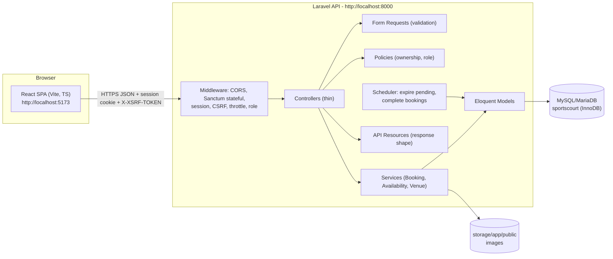
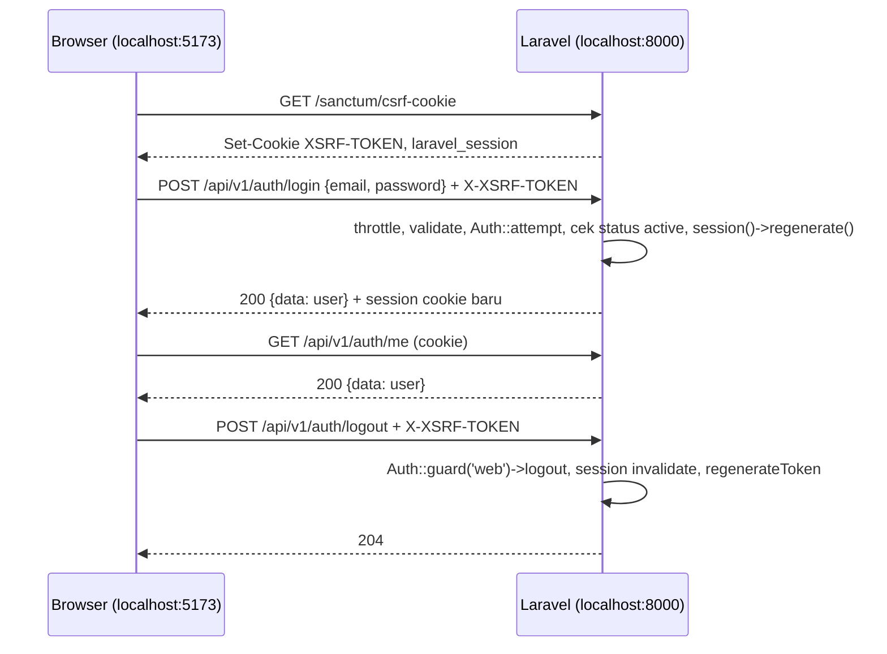
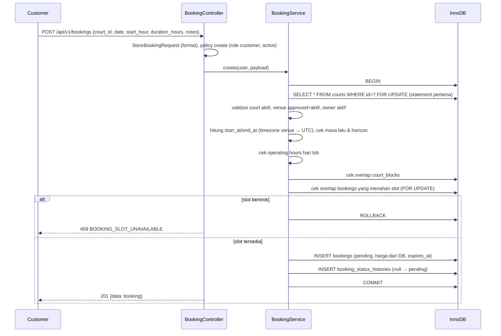

# SportsCourt — System Architecture (Draft v1)

Status: **Draft untuk review**

---

## 1. High-Level Architecture



Prinsip:
- **Backend adalah security boundary.** Frontend guard hanya untuk UX.
- **Controller tipis.** Logika domain yang kompleks (booking, availability, transisi status) ada di service class. CRUD sederhana tetap di controller + Form Request (menghindari overengineering).
- **Identitas dari session**, tidak pernah dari body (`user_id`, `owner_id`, `role`, `price`, `status`).

---

## 2. Backend (Laravel)

### 2.1 Struktur folder (di dalam konvensi Laravel)

```text
backend/
├── app/
│   ├── Console/Commands/
│   │   ├── CreateAdmin.php             # php artisan app:create-admin (interaktif)
│   │   ├── ExpirePendingBookings.php   # bookings:expire-pending
│   │   └── CompleteBookings.php        # bookings:complete
│   ├── Enums/
│   │   ├── UserRole.php
│   │   ├── UserStatus.php
│   │   ├── VenueStatus.php
│   │   └── BookingStatus.php           # termasuk transition map + holdsSlot()
│   ├── Exceptions/
│   │   └── DomainException classes     # SlotUnavailable, InvalidTransition, ...
│   ├── Http/
│   │   ├── Controllers/Api/V1/
│   │   │   ├── Auth/                   # Register, Login, Logout, Me, Profile, Password
│   │   │   ├── Public/                 # Sports, Venues, Courts, Availability
│   │   │   ├── Customer/               # Bookings, Dashboard
│   │   │   ├── Owner/                  # Venues, VenueImages, Courts, OperatingHours, CourtBlocks, Bookings, Dashboard
│   │   │   └── Admin/                  # Dashboard, Users, Venues, Sports, Bookings
│   │   ├── Middleware/EnsureRole.php   # role:owner, role:admin, ...
│   │   ├── Requests/                   # Form Request per endpoint tulis
│   │   └── Resources/                  # UserResource, VenueResource, BookingResource, ...
│   ├── Models/
│   ├── Policies/                       # VenuePolicy, CourtPolicy, CourtBlockPolicy, BookingPolicy
│   └── Services/
│       ├── AvailabilityService.php
│       ├── BookingService.php
│       ├── CourtBlockService.php
│       └── ImageUploadService.php
├── config/sportscourt.php              # TTL, cutoff, horizon, facilities allowlist, max images
├── database/{migrations,factories,seeders}
├── routes/api.php                      # prefix v1
└── tests/{Feature,Unit}
```

### 2.2 Konfigurasi domain (`config/sportscourt.php`, nilai dari `.env`)

| Key | Env | Default |
|-----|-----|---------|
| `booking.pending_ttl_minutes` | `BOOKING_PENDING_TTL_MINUTES` | 120 |
| `booking.cancel_cutoff_hours` | `BOOKING_CANCEL_CUTOFF_HOURS` | 24 |
| `booking.max_days_ahead` | `BOOKING_MAX_DAYS_AHEAD` | 30 |
| `booking.min_duration_hours` | — | 1 |
| `booking.max_duration_hours` | — | 4 |
| `venue.max_images` | — | 5 |
| `venue.timezones` | — | `Asia/Jakarta`, `Asia/Makassar`, `Asia/Jayapura` |
| `venue.facilities` | — | `parking`, `toilet`, `shower`, `canteen`, `musholla`, `wifi`, `locker` |

### 2.3 Response format (konvensi Laravel, terdokumentasi)

- Single resource: `{ "data": { ... } }`
- Collection berpaginasi: `{ "data": [...], "links": {...}, "meta": {...} }` (default `ResourceCollection`)
- Validation error (422): `{ "message": "...", "errors": { "field": ["..."] } }` (default Laravel)
- Error lain: `{ "message": "...", "code": "BOOKING_SLOT_UNAVAILABLE" }` — `code` machine-readable untuk error domain.
- Produksi: `APP_DEBUG=false`, stack trace tidak pernah dikirim ke client.

---

## 3. Frontend (React + TypeScript + Vite)

### 3.1 Library

| Kebutuhan | Pilihan | Alasan |
|-----------|---------|--------|
| Routing | React Router DOM | Wajib PRD |
| Server state | TanStack Query | Cache, loading/error state, invalidation |
| HTTP | Axios | Dukungan bawaan cookie XSRF (`withXSRFToken`), interceptor |
| Form | React Hook Form + Zod | Validasi UX type-safe |
| Styling | Tailwind CSS + shadcn/ui | Komponen accessible (Radix), tidak menambah runtime besar |
| Client state | **Tidak pakai Zustand di awal** | Auth & data = server state (TanStack Query). Tambahkan Zustand hanya jika muncul UI state global yang nyata |
| Tanggal | `date-fns` + `date-fns-tz` | Format waktu lokal venue (P-01) |

### 3.2 Struktur folder

```text
frontend/src/
├── components/{ui,common,layout}     # ui = shadcn, layout = Public/Customer/Owner/Admin layout
├── features/
│   ├── auth/        # api.ts, hooks (useMe, useLogin, useLogout), schemas
│   ├── venues/
│   ├── courts/
│   ├── availability/
│   ├── bookings/
│   ├── owner/
│   └── admin/
├── pages/{auth,customer,owner,admin,public}
├── routes/          # router + RequireAuth + RequireRole (UX only)
├── lib/             # axios instance, queryClient, formatters (IDR, timezone)
├── types/           # tipe API response
└── main.tsx
```

### 3.3 Auth state di frontend
- Sumber kebenaran: `GET /api/v1/auth/me` via TanStack Query (`['auth','me']`).
- **Tidak** menyimpan token/role di `localStorage`.
- Axios: `withCredentials: true`, `withXSRFToken: true`, `baseURL = import.meta.env.VITE_API_URL`.
- Interceptor: `401` → reset query `me` & redirect login; `419` (CSRF mismatch) → ambil ulang `/sanctum/csrf-cookie` lalu retry **sekali**.

---

## 4. Authentication Flow (Sanctum SPA cookie)



Konfigurasi lokal (diverifikasi end-to-end di Phase 3):

| Item | Nilai development |
|------|-------------------|
| `APP_URL` | `http://localhost:8000` |
| `FRONTEND_URL` | `http://localhost:5173` |
| `SANCTUM_STATEFUL_DOMAINS` | `localhost:5173` |
| `SESSION_DRIVER` | `database` |
| `SESSION_DOMAIN` | `localhost` |
| `SESSION_SECURE_COOKIE` | `false` (dev) / `true` (prod) |
| `SESSION_SAME_SITE` | `lax` |
| `SESSION_HTTP_ONLY` | `true` |
| `config/cors.php` | `paths: ['api/*','sanctum/csrf-cookie']`, `allowed_origins: [FRONTEND_URL]`, `supports_credentials: true` |
| `bootstrap/app.php` | `$middleware->statefulApi()` |

---

## 5. Booking Creation Flow (Concurrency-safe)



Aturan locking:
- **Lock row `courts` adalah statement pertama** di transaksi. Semua jalur yang bisa mengubah okupansi court (create booking, create block, confirm booking) mengunci row court yang sama → serialisasi per court, tidak memblokir court lain.
- Overlap query memakai locking read (`lockForUpdate()`) sehingga membaca data **committed terbaru**, bukan snapshot REPEATABLE READ lama.
- Deadlock / lock wait timeout ditangani dengan `DB::transaction($callback, attempts: 3)`; jika tetap gagal → 409/503 yang jelas.
- Rumus overlap: `existing.start_at < :end AND existing.end_at > :start`.

---

## 6. Scheduled Jobs

| Command | Jadwal | Aksi |
|---------|--------|------|
| `bookings:expire-pending` | setiap menit | `pending` dengan `expires_at <= now()` → `expired` + history (changed_by = NULL) |
| `bookings:complete` | setiap 5 menit | `confirmed` dengan `end_at <= now()` → `completed` + history |

Dev lokal: `php artisan schedule:work`. Ketepatan slot **tidak bergantung** pada scheduler karena kondisi "menahan slot" sudah mengecek `expires_at > now()`.

---

## 7. Risiko Teknis & Mitigasi

### 7.1 Sanctum SPA Authentication

| # | Risiko | Gejala | Mitigasi |
|---|--------|--------|----------|
| S1 | Mencampur `localhost` dan `127.0.0.1` | Cookie tidak terkirim, selalu 401 | Konsisten pakai `localhost` di `APP_URL`, `FRONTEND_URL`, `VITE_API_URL`, stateful domains |
| S2 | `SANCTUM_STATEFUL_DOMAINS` tanpa port | Request dianggap stateless → 401 | Isi `localhost:5173` |
| S3 | Axios ≥1.6 tidak otomatis mengirim XSRF header lintas origin | 419 CSRF token mismatch | `withXSRFToken: true` + `withCredentials: true` |
| S4 | CORS wildcard dengan credentials | Browser menolak / celah keamanan | Allowlist eksplisit, `supports_credentials: true` |
| S5 | Session fixation | Session lama tetap valid setelah login | `session()->regenerate()` saat login, `invalidate()` + `regenerateToken()` saat logout |
| S6 | Brute force login | | `throttle` per email+IP (5/menit), pesan error generik |
| S7 | Production lintas domain | Cookie tidak terkirim | Frontend & API harus satu registrable domain (mis. `app.domain.id` + `api.domain.id`), HTTPS, `SESSION_SECURE_COOKIE=true` |
| S8 | User suspended tetap punya session aktif | | Middleware cek `status = active` di setiap request terautentikasi |

### 7.2 Concurrent Booking

| # | Risiko | Mitigasi |
|---|--------|----------|
| C1 | Check-then-insert race (2 request lolos cek overlap bersamaan) | `SELECT ... FOR UPDATE` row court di awal transaksi |
| C2 | Snapshot REPEATABLE READ membaca data lama | Lock court sebagai statement pertama + overlap check sebagai locking read |
| C3 | Owner membuat blokir bersamaan dengan booking | Create block juga lock row court yang sama |
| C4 | Deadlock / lock wait timeout | Urutan lock konsisten (court → booking), retry `attempts: 3`, transaksi singkat (tanpa I/O file/HTTP di dalam transaksi) |
| C5 | Pending expired belum diproses scheduler tetap menahan slot | Kondisi menahan slot memakai `expires_at > now()` |
| C6 | Test concurrency palsu | SQLite in-memory **tidak** mereproduksi row lock → test booking wajib di DB MySQL/MariaDB `sportscourt_test` |
| C7 | `php artisan serve` di Windows memproses request **satu per satu** | Uji concurrency nyata dilakukan (a) di level DB dengan dua koneksi terpisah di PHPUnit dan (b) skrip parallel request ke Apache XAMPP / server multi-worker, ekspektasi: tepat 1 sukses (201), sisanya 409 |

### 7.3 Risiko lain

| # | Risiko | Mitigasi |
|---|--------|----------|
| O1 | Bug timezone (WIB/WITA/WIT, DST tidak ada di Indonesia) | Simpan UTC, konversi hanya di `AvailabilityService`/`BookingService` dan formatter frontend; test lintas zona |
| O2 | XAMPP memakai MariaDB, bukan MySQL | Cek versi di Phase 2, pilih driver Laravel yang sesuai |
| O3 | IDOR/BOLA (owner A mengakses venue owner B) | Policies + query di-scope ke `auth()->user()`; feature test lintas user |
| O4 | Upload file berbahaya | Validasi `mimes`+`max`+`dimensions`, tolak SVG, nama file random, disk `public` tanpa eksekusi PHP |
| O5 | Mass assignment | `$fillable` eksplisit, hanya `$request->validated()` |
| O6 | XSS dari deskripsi venue | React escape default, larang `dangerouslySetInnerHTML` |
