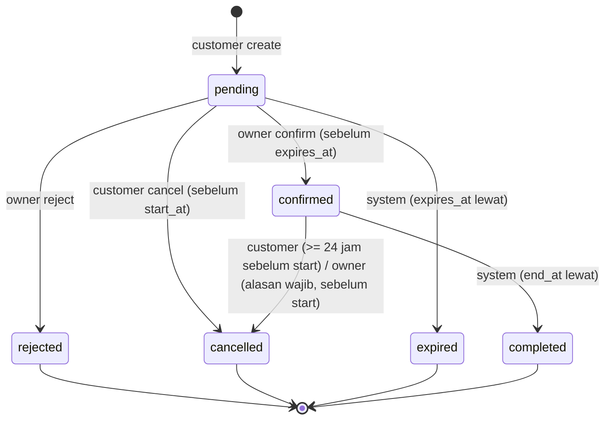
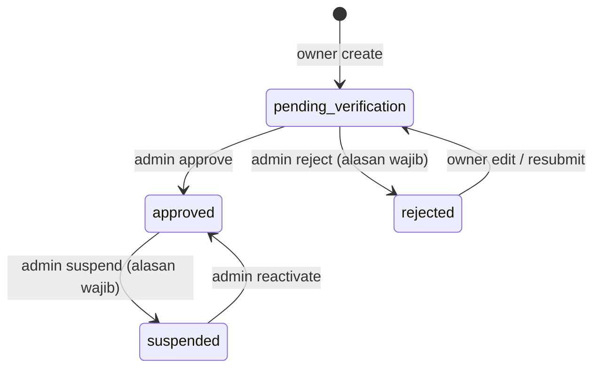

# SportsCourt — ERD & Data Dictionary (Draft v1)

Status: **Draft untuk review** — migration utama tidak dibuat sebelum ERD ini disetujui (PRD §9).

Konvensi:
- Engine **InnoDB**, charset `utf8mb4_unicode_ci`.
- Primary key `id` BIGINT UNSIGNED auto increment (konvensi Laravel).
- Semua `DATETIME`/`TIMESTAMP` disimpan dalam **UTC** (lihat P-01).
- Uang: `DECIMAL(12,2)` dalam IDR.
- FK menggunakan `ON DELETE RESTRICT` kecuali disebutkan lain, agar histori booking tidak rusak.
- Soft delete hanya untuk `venues` dan `courts` (resource yang bisa punya histori booking).

---

## 1. ERD

```mermaid
erDiagram
    users ||--o{ venues : "owns (role=owner)" }
    users ||--o{ bookings : "makes (role=customer)" }
    users ||--o{ booking_status_histories : "changed_by" }
    users ||--o{ court_blocks : "created_by" }
    venues ||--o{ venue_images : has }
    venues ||--o{ operating_hours : has }
    venues ||--o{ courts : has }
    sports ||--o{ courts : categorizes }
    courts ||--o{ court_blocks : has }
    courts ||--o{ bookings : has }
    bookings ||--o{ booking_status_histories : has }

    users {
        bigint id PK
        string name
        string email UK
        string phone "nullable"
        string password "bcrypt/argon hash"
        enum role "customer|owner|admin"
        enum status "active|suspended"
        timestamp email_verified_at "nullable"
        string remember_token "nullable"
        timestamp created_at
        timestamp updated_at
    }

    sports {
        bigint id PK
        string name UK
        string slug UK
        boolean is_active
        timestamp created_at
        timestamp updated_at
    }

    venues {
        bigint id PK
        bigint owner_id FK
        string name
        string slug UK
        text description
        string address
        string city
        string province
        string phone
        string timezone "Asia/Jakarta|Asia/Makassar|Asia/Jayapura"
        json facilities "nullable"
        enum status "pending_verification|approved|rejected|suspended"
        string status_reason "nullable"
        timestamp verified_at "nullable"
        bigint verified_by FK "nullable"
        boolean is_active
        timestamp created_at
        timestamp updated_at
        timestamp deleted_at "nullable"
    }

    venue_images {
        bigint id PK
        bigint venue_id FK
        string path
        tinyint sort_order
        timestamp created_at
        timestamp updated_at
    }

    operating_hours {
        bigint id PK
        bigint venue_id FK
        tinyint day_of_week "1=Mon..7=Sun ISO"
        boolean is_closed
        tinyint open_hour "nullable 0-23"
        tinyint close_hour "nullable 1-24"
        timestamp created_at
        timestamp updated_at
    }

    courts {
        bigint id PK
        bigint venue_id FK
        bigint sport_id FK
        string name
        text description "nullable"
        decimal price_per_hour "12,2"
        string image_path "nullable"
        boolean is_active
        timestamp created_at
        timestamp updated_at
        timestamp deleted_at "nullable"
    }

    court_blocks {
        bigint id PK
        bigint court_id FK
        datetime start_at "UTC"
        datetime end_at "UTC"
        string reason
        bigint created_by FK
        timestamp created_at
        timestamp updated_at
    }

    bookings {
        bigint id PK
        string code UK "public reference"
        bigint user_id FK
        bigint court_id FK
        datetime start_at "UTC"
        datetime end_at "UTC"
        decimal price_per_hour "snapshot"
        decimal total_price
        enum status "pending|confirmed|rejected|cancelled|completed|expired"
        datetime expires_at "nullable"
        string notes "nullable"
        timestamp created_at
        timestamp updated_at
    }

    booking_status_histories {
        bigint id PK
        bigint booking_id FK
        enum from_status "nullable"
        enum to_status
        bigint changed_by FK "nullable = system"
        string reason "nullable"
        timestamp created_at
    }
```

> **Catatan desain `court_schedules`** (PRD §9): diganti nama menjadi **`court_blocks`** dan **hanya menyimpan periode blokir**. Slot availability **tidak disimpan** (dihitung on-the-fly dari `operating_hours` − `court_blocks` − `bookings` aktif) untuk menghindari data turunan yang redundan dan rawan tidak sinkron.

---

## 2. Data Dictionary

### 2.1 `users`
| Kolom | Tipe | Null | Keterangan |
|-------|------|------|------------|
| id | BIGINT UNSIGNED | No | PK |
| name | VARCHAR(100) | No | |
| email | VARCHAR(255) | No | **UNIQUE**, disimpan lowercase |
| phone | VARCHAR(20) | Yes | |
| password | VARCHAR(255) | No | Hash Laravel (`hashed` cast). Tidak pernah dikirim di response |
| role | ENUM('customer','owner','admin') | No | Default `customer`. **Tidak bisa** di-set dari request publik (admin hanya via artisan command) |
| status | ENUM('active','suspended') | No | Default `active`. Suspended tidak bisa login |
| email_verified_at | TIMESTAMP | Yes | Disiapkan; verifikasi email di luar scope MVP |
| remember_token | VARCHAR(100) | Yes | |
| created_at / updated_at | TIMESTAMP | Yes | |

Index: `UNIQUE(email)`, `INDEX(role, status)`.

### 2.2 `sports`
| Kolom | Tipe | Null | Keterangan |
|-------|------|------|------------|
| id | BIGINT UNSIGNED | No | PK |
| name | VARCHAR(50) | No | **UNIQUE** (Badminton, Futsal, Basket, Tenis, Padel, …) |
| slug | VARCHAR(60) | No | **UNIQUE**, untuk filter URL |
| is_active | BOOLEAN | No | Default `true`. Kategori nonaktif tidak bisa dipilih untuk court baru |

Seeder: kategori awal. Kategori yang sudah dipakai court tidak dihapus, hanya dinonaktifkan.

### 2.3 `venues`
| Kolom | Tipe | Null | Keterangan |
|-------|------|------|------------|
| id | BIGINT UNSIGNED | No | PK |
| owner_id | BIGINT UNSIGNED | No | FK → `users.id` (RESTRICT). Diisi dari session, **bukan** dari request |
| name | VARCHAR(150) | No | |
| slug | VARCHAR(180) | No | **UNIQUE**, generated server-side |
| description | TEXT | No | Dirender sebagai plain text di frontend (tanpa `dangerouslySetInnerHTML`) |
| address | VARCHAR(255) | No | |
| city | VARCHAR(100) | No | |
| province | VARCHAR(100) | No | |
| phone | VARCHAR(20) | No | |
| timezone | VARCHAR(40) | No | Allowlist 3 zona WIB/WITA/WIT, default `Asia/Jakarta` |
| facilities | JSON | Yes | Array key dari allowlist config (P-09) |
| status | ENUM(...) | No | Default `pending_verification`. Hanya admin yang bisa mengubah ke `approved`/`rejected`/`suspended` |
| status_reason | VARCHAR(500) | Yes | Alasan reject/suspend dari admin |
| verified_at | TIMESTAMP | Yes | |
| verified_by | BIGINT UNSIGNED | Yes | FK → `users.id` (SET NULL) |
| is_active | BOOLEAN | No | Toggle owner (nonaktifkan venue tanpa menghapus) |
| deleted_at | TIMESTAMP | Yes | Soft delete |

Index: `INDEX(owner_id)`, `INDEX(status, is_active)`, `INDEX(city)`, `INDEX(name)`.
**Visibilitas publik:** `status = approved AND is_active = true AND deleted_at IS NULL AND owner.status = active`.

### 2.4 `venue_images`
| Kolom | Tipe | Null | Keterangan |
|-------|------|------|------------|
| id | BIGINT UNSIGNED | No | PK |
| venue_id | BIGINT UNSIGNED | No | FK → `venues.id` (CASCADE — gambar ikut venue) |
| path | VARCHAR(255) | No | Path relatif di disk `public`, nama file random dari server |
| sort_order | TINYINT UNSIGNED | No | 0 = cover |

Batas: maksimal 5 gambar per venue (divalidasi di service).

### 2.5 `operating_hours`
| Kolom | Tipe | Null | Keterangan |
|-------|------|------|------------|
| id | BIGINT UNSIGNED | No | PK |
| venue_id | BIGINT UNSIGNED | No | FK → `venues.id` (CASCADE) |
| day_of_week | TINYINT UNSIGNED | No | ISO 1 (Senin) – 7 (Minggu) |
| is_closed | BOOLEAN | No | |
| open_hour | TINYINT UNSIGNED | Yes | 0–23, wajib jika `is_closed = false` |
| close_hour | TINYINT UNSIGNED | Yes | 1–24, `> open_hour` |

Index: **`UNIQUE(venue_id, day_of_week)`**. Selalu 7 baris per venue (dibuat otomatis saat venue dibuat, default 08–22).

### 2.6 `courts`
| Kolom | Tipe | Null | Keterangan |
|-------|------|------|------------|
| id | BIGINT UNSIGNED | No | PK. **Row ini yang di-lock** saat create booking / create block |
| venue_id | BIGINT UNSIGNED | No | FK → `venues.id` (RESTRICT) |
| sport_id | BIGINT UNSIGNED | No | FK → `sports.id` (RESTRICT) |
| name | VARCHAR(100) | No | Unik per venue (divalidasi di aplikasi karena soft delete) |
| description | TEXT | Yes | |
| price_per_hour | DECIMAL(12,2) | No | `> 0`, maks 99.999.999,99 |
| image_path | VARCHAR(255) | Yes | |
| is_active | BOOLEAN | No | |
| deleted_at | TIMESTAMP | Yes | Soft delete. Tidak bisa dihapus jika masih punya booking aktif mendatang |

Index: `INDEX(venue_id, is_active)`, `INDEX(sport_id)`, `INDEX(price_per_hour)`.
"Harga mulai dari" di kartu venue dihitung dengan `withMin('courts', 'price_per_hour')` — tidak disimpan.

### 2.7 `court_blocks`
| Kolom | Tipe | Null | Keterangan |
|-------|------|------|------------|
| id | BIGINT UNSIGNED | No | PK |
| court_id | BIGINT UNSIGNED | No | FK → `courts.id` (CASCADE) |
| start_at | DATETIME | No | UTC, jam bulat waktu lokal venue |
| end_at | DATETIME | No | UTC, `> start_at` |
| reason | VARCHAR(255) | No | Maintenance / event / dll. Tidak ditampilkan ke customer (hanya status `blocked`) |
| created_by | BIGINT UNSIGNED | No | FK → `users.id` |

Index: `INDEX(court_id, start_at, end_at)`. Tidak boleh overlap dengan booking aktif (P-06).

### 2.8 `bookings`
| Kolom | Tipe | Null | Keterangan |
|-------|------|------|------------|
| id | BIGINT UNSIGNED | No | PK |
| code | VARCHAR(20) | No | **UNIQUE**, contoh `SC-7F3K9Q2M` (random, non-sequential) untuk ditampilkan ke user |
| user_id | BIGINT UNSIGNED | No | FK → `users.id` (RESTRICT). Dari session |
| court_id | BIGINT UNSIGNED | No | FK → `courts.id` (RESTRICT) |
| start_at | DATETIME | No | UTC |
| end_at | DATETIME | No | UTC, interval `[start_at, end_at)` |
| price_per_hour | DECIMAL(12,2) | No | **Snapshot** harga court saat booking dibuat (bukan redundansi: harga court bisa berubah, histori harus tetap) |
| total_price | DECIMAL(12,2) | No | `price_per_hour × durasi jam`, dihitung server |
| status | ENUM(...) | No | Default `pending` |
| expires_at | DATETIME | Yes | Diisi saat `pending` (D-03) |
| notes | VARCHAR(500) | Yes | Catatan customer, plain text |

Index:
- `INDEX(court_id, start_at, end_at)` — query overlap & availability.
- `INDEX(user_id, start_at)` — riwayat customer.
- `INDEX(status, expires_at)` — job expiration.
- `INDEX(status, end_at)` — job completion.

**Status yang menahan slot (BR-014):**
`status = 'confirmed' OR (status = 'pending' AND expires_at > NOW())`

### 2.9 `booking_status_histories`
| Kolom | Tipe | Null | Keterangan |
|-------|------|------|------------|
| id | BIGINT UNSIGNED | No | PK |
| booking_id | BIGINT UNSIGNED | No | FK → `bookings.id` (RESTRICT) |
| from_status | ENUM(...) | Yes | `NULL` untuk pembuatan |
| to_status | ENUM(...) | No | |
| changed_by | BIGINT UNSIGNED | Yes | FK → `users.id`. `NULL` = sistem (scheduler) |
| reason | VARCHAR(500) | Yes | |
| created_at | TIMESTAMP | No | Append-only, tidak ada `updated_at` |

Index: `INDEX(booking_id, created_at)`.

### 2.10 Tabel bawaan Laravel
`sessions` (SESSION_DRIVER=database), `password_reset_tokens`, `cache`, `cache_locks`, `jobs`, `failed_jobs`. `personal_access_tokens` tidak digunakan (SPA cookie flow).

---

## 3. Booking State Machine



Setiap transisi:
1. Divalidasi oleh `BookingStatus::canTransitionTo()` + policy aktor.
2. Dijalankan dalam DB transaction dengan `lockForUpdate()` pada row booking.
3. Menulis satu baris ke `booking_status_histories`.

## 4. Venue Status Machine



Booking `pending`/`confirmed` mendatang pada venue yang di-suspend **tidak otomatis dibatalkan** di MVP; venue hanya disembunyikan dari pencarian dan tidak menerima booking baru. (Perlu konfirmasi jika ingin auto-cancel.)
